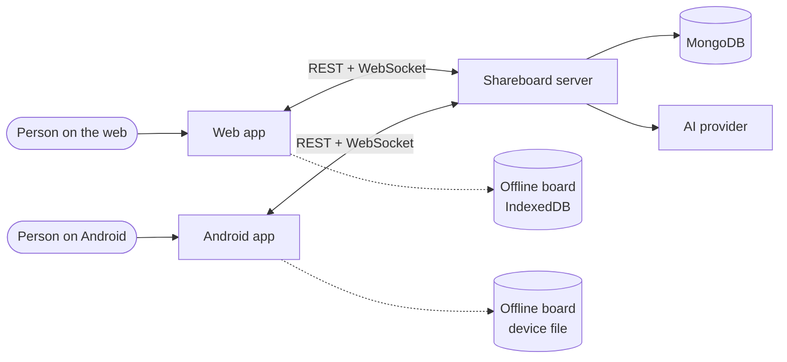

# 1. Product overview

## 1.1 Purpose

Shareboard is an infinite whiteboard that several people draw on at the same
time, from a browser or an Android phone. It opens ready to draw, with no
sign-up, and a board is shared by reading out a six-character code.

The problem it solves: most collaborative boards make people create an
account, pick a workspace and learn a dense toolbar before the first stroke.
In a classroom, a meeting or a quick call, that cost is larger than the
drawing itself. Shareboard removes it.

> **Success criterion.** A first-time user draws something and then shares it
> with another person without any help.

## 1.2 Scope

**In scope**

- Freehand drawing, figures, lines and arrows that connect figures, text,
  sticky notes, images.
- Real-time collaboration: live strokes, named cursors, presence, reactions,
  a shared timer.
- Sharing by code, link or QR; public or PIN-protected boards; per-person
  editing rights.
- An offline board that lives only on the device.
- Export to PNG, JPG, SVG and JSON; exported pictures re-import as editable
  boards.
- AI drawing from a text prompt.
- Optional accounts (username, email, password) to own and share boards.

**Out of scope (current release)**

- iOS native app (iPhone and iPad users use the web app).
- Multiple pages or frames per board, presentation mode.
- Comments and threaded discussion on elements.
- Version history beyond the per-user undo stack.
- Paid plans, organisations, admin consoles.

## 1.3 The product in one picture

1. **Clients.** The web app (React) and the Android app (Expo / React
   Native) offer the same features and the same mental model.
2. **Server.** The single authority: validates and orders every change,
   checks permissions, keeps live boards in memory and persists them to
   MongoDB.
3. **Offline board.** Each device keeps one private board that needs no
   network. The app always opens on it.

## 1.4 Actors and roles

| Actor | Description |
|-------|-------------|
| **Guest** | Anyone using the app without an account. Identified by a random device id, a nickname and a colour. Can draw on the offline board and join boards shared with them. |
| **Account holder** | A guest who registered (username, email, password). Can share boards, create new live boards, import files as boards, and find their boards on any device. |
| **Creator** | The account that created or shared a live board. Owns its name, visibility, PIN, editing policy, and can clear or delete it. |
| **Editor** | A participant allowed to draw on a live board by the editing policy. |
| **Viewer** | A participant who can only watch (read-only); tools are hidden. |
| **Server** | System actor: validates, orders, broadcasts and stores changes. |
| **AI provider** | External system that turns a text prompt into drawing items. |

A single person can hold several roles: e.g. a creator on one board and a
viewer on another.

## 1.5 Main concepts (glossary)

| Term | Meaning |
|------|---------|
| **Board** | An infinite canvas holding elements. Either *offline* (on one device) or *live* (on the server). |
| **Element** | One thing on a board: stroke, figure, line/arrow, text, sticky note, image. |
| **Operation (op)** | A small change: add, patch or delete elements. Every edit is an op. |
| **Short code** | Six characters (no look-alikes such as 0/O, 1/I/L) that identify a live board, shown as `K7M·Q2R`. |
| **PIN** | Four digits that protect a private board. |
| **Editing policy** | *Everyone*, *Selected people* or *Only me*. |
| **Selection lock** | While someone has an element selected, nobody else can change it. |
| **Hold to shape** | Holding the pencil still at the end of a stroke turns it into a clean figure. |
| **Sheet** | A panel that slides up (phone) or appears as a card (desktop) for a secondary task: share, menu, settings… |

## 1.6 Feature map

| Area | Features |
|------|----------|
| Canvas | Infinite pan and zoom (10 %–2,000 %), dot grid, light/dark board, fit to content, undo/redo (100 steps, own changes only) |
| Tools | Cursor, hand, pencil (pen, highlighter, laser), eraser, rectangle, circle, triangle, polygon, line, arrow, sticky note (and vote dot), text, fill |
| Styling | Colour palette + HEX picker, 4 widths, solid/dashed/dotted, fill with opacity, sharp/rounded corners, 4 fonts, 4 text sizes, bold/italic/underline, alignment, 15 line-end markers, straight/curved/elbow routes |
| Editing | Select, multi-select, move, resize, rotate, group, z-order, copy/cut/paste/duplicate/delete, lock/unlock, labels on figures and lines |
| Smart drawing | Hold to shape, arrows that attach to figures, templates (brainstorm, retro, flowchart, Kanban, mind map), Draw with AI |
| Collaboration | Live ops, cursors, presence list, reactions, countdown timer, multi-device per person, connection status |
| Sharing & access | Code, link, QR, WhatsApp/system share (Android); public/private; PIN; editing policy; rename, clear, delete |
| Files | Export PNG/JPG/SVG/JSON, transparent background, selection-only, editable round-trip; import JSON, pictures, images |
| Accounts | Register, sign in, email verification, password reset, change password/email, sign out |
| Personalisation | Nickname, icon colour, language (ES/EN), grid, cursors, smoothing, haptics, tutorial replay |

## 1.7 Platforms and environments

| | Web | Android | Server |
|--|-----|---------|--------|
| Technology | React 19, Vite, Tailwind 4, Canvas 2D | Expo, React Native, Skia, Reanimated | Node 22, Fastify 5, `ws`, MongoDB |
| Distribution | Static SPA on Vercel | APK on GitHub Releases | Render web service |
| Input | Mouse, trackpad, keyboard, touch, pen | Touch, stylus | — |
| Offline storage | IndexedDB | Device file | — |

## 1.8 Assumptions and constraints

- One server instance serves all live boards (sized for ~100 concurrent
  users). See [NFR-SC](non-functional-requirements.md#scalability).
- The web and Android clients share **no code at build time**; the data
  model and protocol are mirrored by hand in three places.
- The AI feature depends on a third-party provider and on network access.
- The interface is bilingual (Spanish default, English).

## 1.9 Related documents

- [User guide → Features](../user-guide/features.md), end-user wording of
  every feature.
- [Architecture overview](../architecture/overview.md), [data model](../architecture/data-model.md),
  [communication protocol](../architecture/communication.md).
- [Design planning](../design-planning/mockups.html): mockups, design system,
  navigation, product vision.
