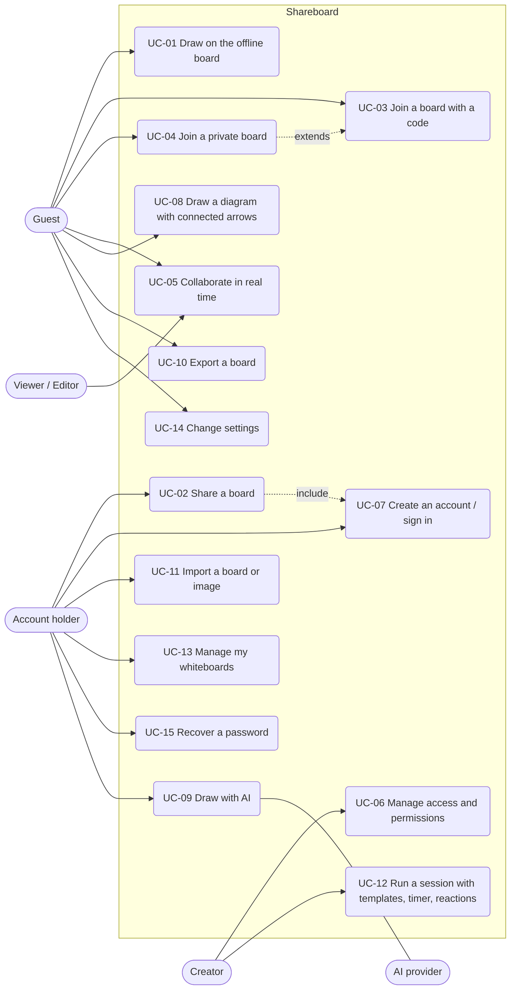

# 4. Use cases

## 4.1 Use case diagram

Account holder inherits everything a guest can do; creator inherits
everything an account holder can do.

## 4.2 Summary

| ID | Name | Primary actor | Priority | Main FRs |
|----|------|---------------|----------|----------|
| UC-01 | Draw on the offline board | Guest | M | FR-1, FR-4, FR-5, FR-6 |
| UC-02 | Share a board | Account holder | M | FR-10, FR-2.10 |
| UC-03 | Join a board with a code | Guest | M | FR-10.4, FR-2.2 |
| UC-04 | Join a private board | Guest | M | FR-11.3 |
| UC-05 | Collaborate in real time | Editor | M | FR-9 |
| UC-06 | Manage access and permissions | Creator | M | FR-11 |
| UC-07 | Create an account / sign in | Guest | M | FR-2 |
| UC-08 | Draw a diagram with connected arrows | Editor | M | FR-8.1, FR-8.2, FR-7 |
| UC-09 | Draw with AI | Editor | S | FR-8.4 |
| UC-10 | Export a board | Any user | M | FR-12.1–12.6 |
| UC-11 | Import a board or image | Account holder | S | FR-12.7–12.8 |
| UC-12 | Run a session with templates, timer and reactions | Creator | S | FR-8.3, FR-9.6, FR-9.7 |
| UC-13 | Manage my whiteboards | Account holder | M | FR-3 |
| UC-14 | Change settings | Any user | M | FR-13 |
| UC-15 | Recover a password | Account holder | S | FR-2.8 |

---

## 4.3 Detailed use cases

### UC-01 Draw on the offline board

| | |
|--|--|
| **Actor** | Guest |
| **Goal** | Start drawing immediately, with or without internet. |
| **Preconditions** | App installed (Android) or web page reachable. |
| **Trigger** | User opens Shareboard. |

**Main flow**
1. The app opens on *My board*, labelled *Only on this device*.
2. On first launch a short tutorial offers itself; the user skips it.
3. The user picks the pencil and draws; the stroke appears as drawn.
4. The user picks a figure, drags a rectangle; the cursor returns with it selected.
5. The user changes the colour in the options strip.
6. The user closes the app; the drawing is saved on the device.

**Alternative flows**
- 2a. The user follows the tutorial: six steps highlight pencil, options, hold to shape, cursor, arrows/text and Share.
- 3a. The user holds the pencil still at the end of a rough circle: it becomes a clean ellipse (FR-8.1).

**Postconditions** The drawing persists locally; nothing was sent to the server.

---

### UC-02 Share a board

| | |
|--|--|
| **Actor** | Account holder |
| **Goal** | Let other people draw on the same board. |
| **Preconditions** | User is on a board. |
| **Trigger** | User taps **Share**. |

**Main flow**
1. On the offline board, the share sheet offers *Share this board* or *Create a new shared board*.
2. The user chooses *Share this board*.
3. If not signed in, the app explains *Sharing a board needs an account* and runs UC-07; then returns here.
4. If the email is not verified, the user enters the 6-digit code sent by email.
5. The server creates a live board from a copy of the offline board and returns its code.
6. The app opens the live board; the share sheet shows the code `K7M·Q2R`, the link and the QR.
7. The user taps the code (copied) or the link, and sends it to others.

**Alternative flows**
- 1a. On a live board, step 6 is shown directly.
- 7a. [A] The user taps *WhatsApp* or *More…* to use the system share sheet.

**Exceptions**
- 5e. Rate limit or network error → toast *Could not create the board*; the offline board is unchanged.

**Postconditions** A live board exists, the user is its creator; the offline board remains a private copy.

---

### UC-03 Join a board with a code

| | |
|--|--|
| **Actor** | Guest |
| **Goal** | Enter a board someone shared. |
| **Trigger** | User opens a `/b/<code>` link, scans the QR, or uses *Menu → New / Join → Join with a code*. |

**Main flow**
1. The user types or pastes the code (or link) and taps *Join*.
2. The app normalises it and asks the server for the board.
3. If the user has no nickname yet, the identity screen asks *What should we call you?* with a colour.
4. The app joins and opens the WebSocket; the board loads with everyone's cursors.

**Alternative flows**
- 2a. The board is private → UC-04.

**Exceptions**
- 1e. Malformed input → *Enter a 6-character code or a link*.
- 2e. Unknown code → *Could not open that board* / board-not-found page with *Back*.
- 3e. Nickname taken on this board → identity screen again with *That name is already used on this board*.

**Postconditions** The user is a participant (editor or viewer per policy).

---

### UC-04 Join a private board

| | |
|--|--|
| **Actor** | Guest |
| **Preconditions** | UC-03 reached a board with a PIN; user is not its creator and has not entered before with an account. |

**Main flow**
1. A full-screen keypad shows *Private board — Ask the creator for the 4-digit PIN*.
2. The user enters four digits; the app submits on the fourth.
3. The server accepts; the board opens.

**Exceptions**
- 3e. Wrong PIN → *Wrong PIN. Give it another go.*; dots clear.
- 3e'. Five wrong attempts in a minute → rate limited; the user waits.

---

### UC-05 Collaborate in real time

| | |
|--|--|
| **Actor** | Editor (others: viewers, server) |
| **Preconditions** | Two or more people on the same live board. |

**Main flow**
1. The header shows *3 online*; each person's cursor shows their name.
2. Ana draws a stroke; it appears on Ben's screen almost at once.
3. Ben selects a sticky note; while he holds it, Ana cannot move it.
4. Ana sends a 👍 reaction; it floats up on all screens.
5. Ana undoes; only her own last change is taken back.

**Alternative flows**
- 2a. Connection drops → header shows *Reconnecting…*, board turns read-only, reconnects and resyncs automatically.
- 2b. A viewer sees all changes live but has no tools; the header says *View only*.

---

### UC-06 Manage access and permissions

| | |
|--|--|
| **Actor** | Creator |
| **Trigger** | *Share → Access* or *Menu → Access*. |

**Main flow**
1. The access sheet shows *Visibility* (Public / Private) and *Who can edit* (Everyone / Selected people / Only me).
2. The creator switches to *Private*; a PIN is generated and shown with *New PIN*.
3. The creator chooses *Selected people*, then in the people list taps names to toggle *Can edit* / *View only*.
4. Each change applies at once to everyone; a toast confirms *Access updated*.

**Exceptions**
- 4e. Server rejects → the switch returns to its previous value; *Could not save the access settings*.

**Postconditions** Non-editors lose tools instantly; new joiners need the PIN.

---

### UC-07 Create an account / sign in

| | |
|--|--|
| **Actor** | Guest |
| **Trigger** | An action that needs an account (UC-02, UC-11, new live board) or *Settings → Account*. |

**Main flow**
1. The account sheet explains *Keep your boards* and offers *Create account* / *Sign in*.
2. The user enters username, email and password (hints and inline validation).
3. The server creates the account; the user keeps their nickname, icon and boards.
4. A 6-digit code is emailed; the user enters it (*Verify your email*).
5. The app returns to the action that asked for the account.

**Alternative flows**
- 1a. *Sign in* with username or email and password.
- 1b. *Not now* closes the sheet; the action is not performed.

**Exceptions** *That username is taken*, *That email already has an account*, *Wrong username, email or password*, rate limiting.

---

### UC-08 Draw a diagram with connected arrows

| | |
|--|--|
| **Actor** | Editor |

**Main flow**
1. The user draws two rectangles and types a label in each (*Aa* or start typing).
2. The user picks the arrow and drags from the first rectangle to the second; connection points appear and the target point is framed.
3. On release both ends attach.
4. The user moves the second rectangle; the arrow follows.
5. The user sets the arrow to *Elbow*; it leaves the figure straight and routes around it.

**Alternative flows**
- 2a. The user draws a rough arrow with the pencil and holds still: a small loop at the end becomes the arrowhead (FR-8.1).

---

### UC-09 Draw with AI

| | |
|--|--|
| **Actor** | Editor; AI provider |
| **Preconditions** | Online. |

**Main flow**
1. *Menu → Draw with AI* (or ✦); the user types *a login flow diagram* and taps *Draw*.
2. The sheet shows *Drawing…*, then a preview.
3. The user taps *Add to board*; the elements are placed at the centre of the screen as normal figures, arrows and text.

**Alternative flows** 3a. *Discard* → nothing is added.

**Exceptions** Offline → *AI needs a connection*; provider error or rate limit → message, no change.

---

### UC-10 Export a board

**Actor** Any user. **Trigger** *Menu → Export* or *Share → Export*.

1. The export sheet shows a preview, size and element count.
2. The user picks PNG / JPG / SVG, whole board or selection, and transparent background if wanted.
3. The user taps *Download* ([W] or *Copy image*; [A] *Share image*).
4. Optionally *Export .json file*.

**Postconditions** The picture carries the board inside (PNG/JPG) and can be imported back as editable (UC-11).

---

### UC-11 Import a board or image

**Actor** Account holder (a picture onto the current board needs no account).

1. *Menu → Import a board*, *Choose file* (or drop it on the web page).
2. A Shareboard `.json` or exported picture → a **new live board** opens with every element editable.
3. Any other picture → placed on the current board as an image.

**Alternative** 2a. *Restore editable strokes and text* turned off → added as a flat picture.

**Rule** Import never overwrites an existing board.

---

### UC-12 Run a session with templates, timer and reactions

**Actor** Creator (e.g. a teacher or facilitator).

1. *Menu → Templates → Retro*; three locked columns appear at the centre.
2. Participants add sticky notes in their colours; the creator asks for *Vote dots*.
3. The creator starts a 5-minute timer; everyone sees the countdown and *Time's up!*.
4. Participants react with emojis.
5. The creator exports the result (UC-10).

---

### UC-13 Manage my whiteboards

**Actor** Account holder.

1. *Menu → My whiteboards* lists *My board* (offline) first, then live boards with last-opened time and *Yours* / *Private* badges.
2. The user taps a board; it opens in place.
3. *Menu → New / Join* creates a blank live board with an optional name.
4. The creator renames, clears (undoable once) or deletes a board from *Settings*, confirming destructive actions.

---

### UC-14 Change settings

**Actor** Any user.

1. *Menu → Settings*.
2. The user changes name and icon, language, dark board, dot grid, others' cursors, smooth strokes, haptics (Android), or replays the tutorial.
3. Changes apply immediately and are remembered on this device.

---

### UC-15 Recover a password

**Actor** Account holder.

1. *Sign in → Forgot your password?*
2. The user enters the account email and taps *Send code*.
3. The user enters the 6-digit code and a new password.
4. The user is signed in; other sessions are signed out.

**Exception** *Wrong or expired code. Ask for a new one.*
